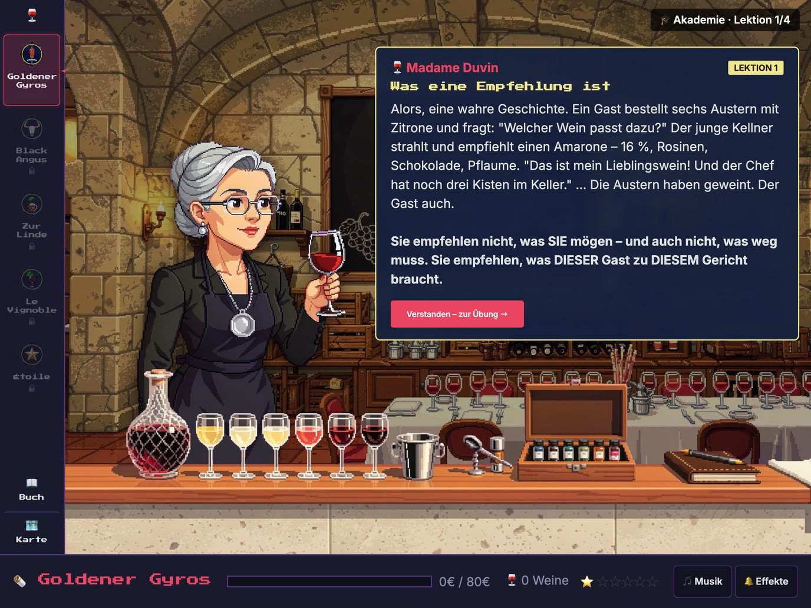
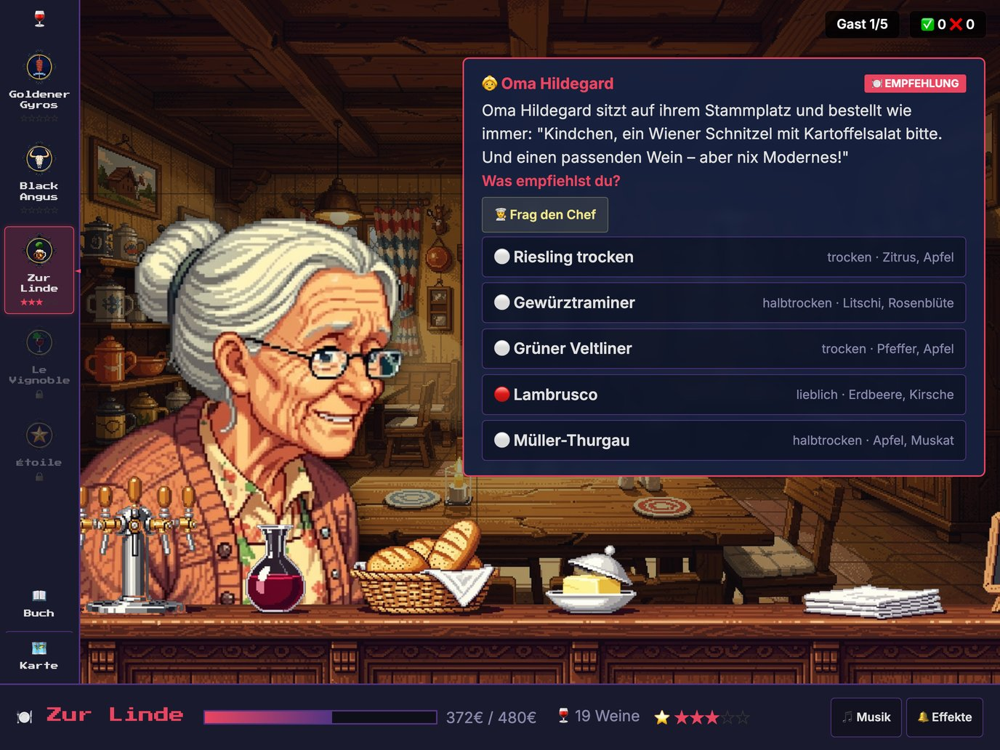
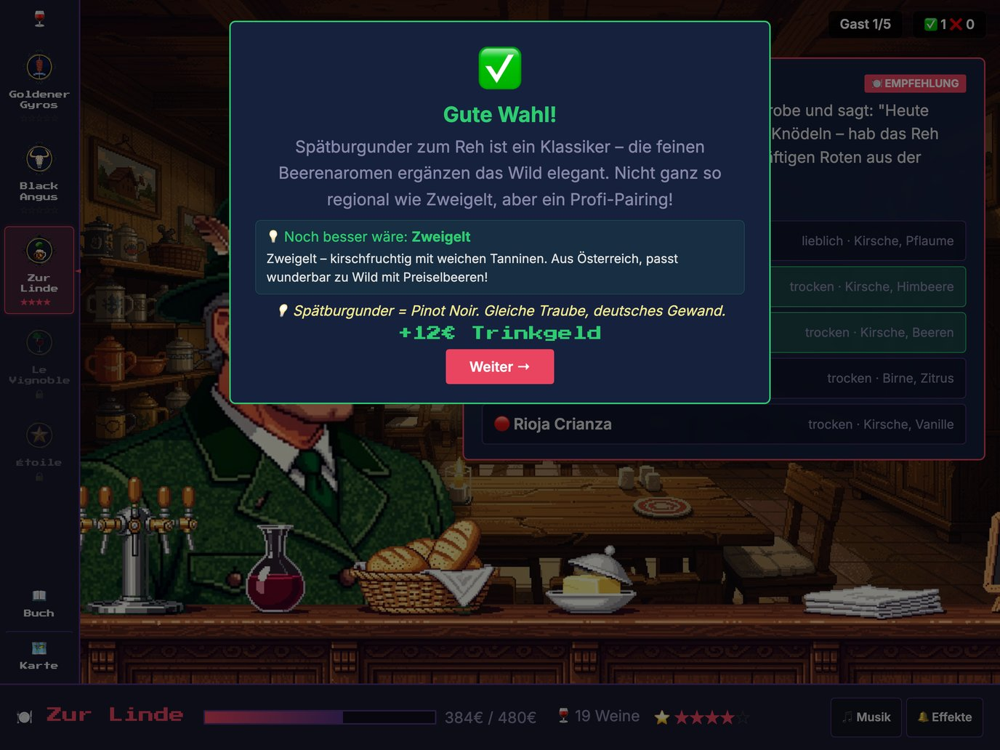
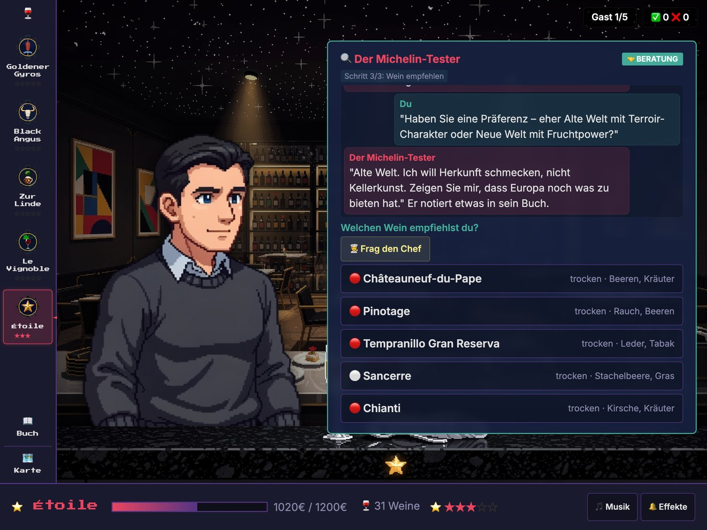
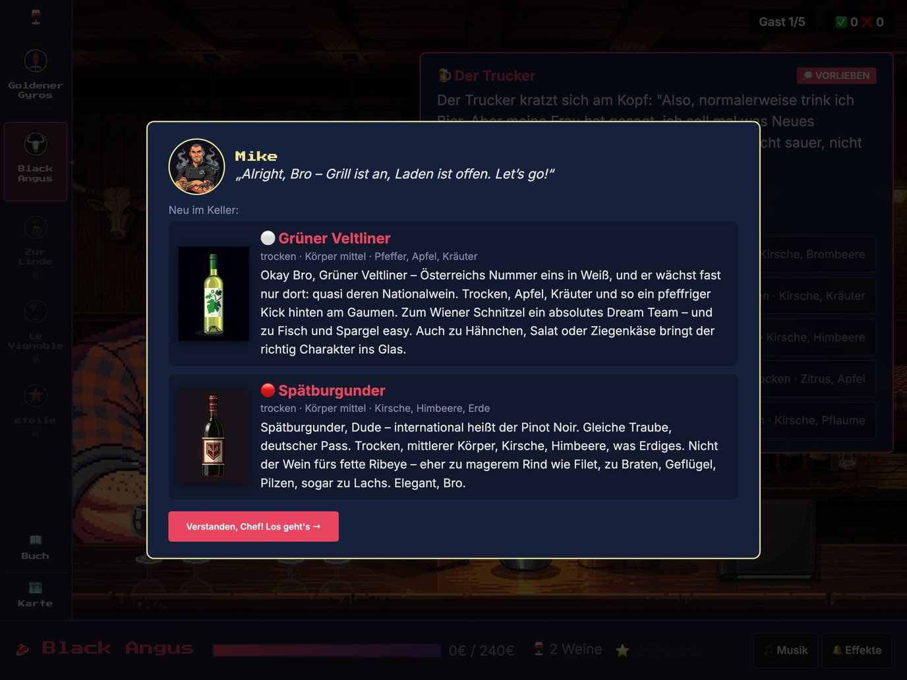
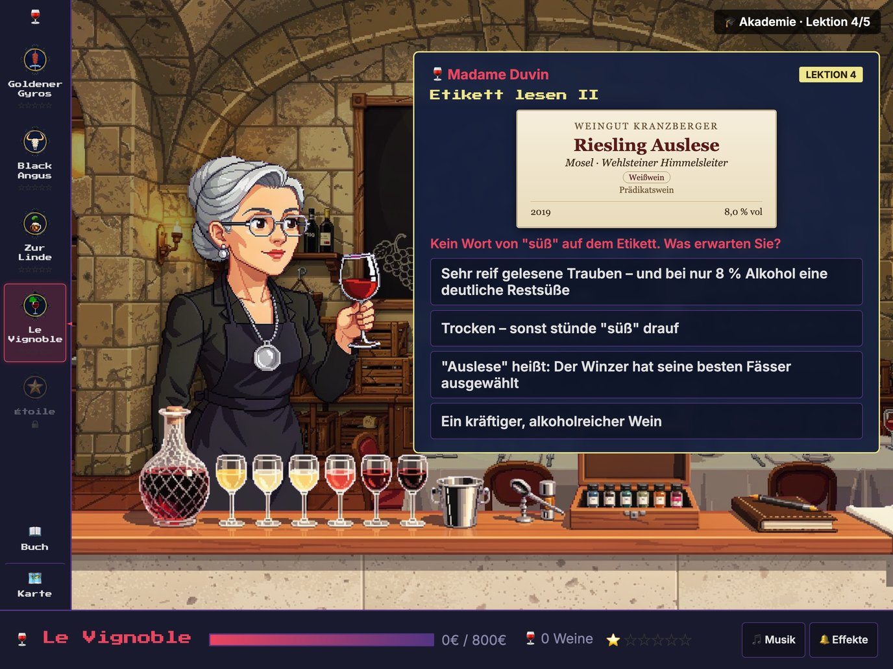

# Der Sommelier

> Ein Lernspiel über Wein und Gästeberatung für Auszubildende in Gastronomie und Service. Du arbeitest dich vom Imbiss bis ins Sterne-Restaurant hoch und lernst dabei, Gäste so zu beraten, dass der Wein zum Gericht und zum Gast passt.


**Spielen:** im Browser unter [beiti.me/games/sommelier](https://beiti.me/games/sommelier), ohne Installation und ohne Konto. Die kostenlose iPad-App erscheint in Kürze im App Store.
**Für Lehrkräfte:** [Begleitheft als PDF](der_sommelier_inhalte.pdf) mit Lehrplanbezug, Vorschlag für eine Unterrichtseinheit und einer Übersicht pro Restaurant.
**Projektseite:** [beiti.me/games/sommelier-info](https://beiti.me/games/sommelier-info/)

## Spielkonzept

Du beginnst im Imbiss „Zum Goldenen Gyros“ und wechselst mit wachsender Erfahrung ins Steakhaus, ins Gasthaus, ins Restaurant „Le Vignoble“ und schließlich ins Sterne-Restaurant „Étoile“. Jedes Haus hat einen eigenen Chef, eigene Stammgäste und eine eigene Weinkarte.

Vor jedem Restaurant besuchst du die Sommelier-Akademie. Madame Duvin erklärt dort in kurzen Lektionen, was du für die nächste Station brauchst, und zu jeder Lektion gibt es eine Übung. Wer zweimal danebenliegt, bekommt eine zweite Aufgabe zum selben Thema. Im Restaurant stellt der Chef vor den ersten Schichten seine Weine vor; erst danach kommen Gäste, die nach genau diesen Weinen fragen. Nach jeder Antwort erklärt das Spiel, warum die Empfehlung passt oder nicht passt und welcher Wein die beste Wahl gewesen wäre.

Am Ende prüft dich der Michelin-Tester mit einem Menü aus sieben Gängen. Wer besteht, sieht den Abspann und trägt sich in die Bestenliste ein.

| Nr. | Restaurant | Chef | Schwerpunkt | Neue Weinländer | Levelcode |
|---|---|---|---|---|---|
| 1 | Imbiss „Zum Goldenen Gyros“ | Kostas | Basics und Weinstile | Deutschland, Italien, Griechenland | (Start) |
| 2 | Steakhaus „Black Angus“ | Mike | Rebsorten und Charakter | Österreich, Frankreich | `RIESLING` |
| 3 | Gasthaus „Zur Linde“ | Frau Lindner | Wein und Essen | Spanien, Portugal | `TERROIR` |
| 4 | Restaurant „Le Vignoble“ | Monsieur Laurent | Terroir und Weinbereitung | Argentinien, Südafrika | `BARRIQUE` |
| 5 | Sterne-Restaurant „Étoile“ | Chef Beaumont | Verkostung und Weinsprache | keine | `SOMMELIER` |

Mit dem Levelcode („Levelcode eingeben“ auf dem Titelbildschirm) startet das Spiel direkt im jeweiligen Restaurant, beginnend mit dem passenden Akademie-Tag. Das ist vor allem für den Unterricht gedacht.

## Screenshots

<table>
<tr>
<td width="50%"><b>Akademie:</b> Madame Duvin erklärt, danach folgt eine Übung<br></td>
<td width="50%"><b>Gast:</b> Oma Hildegard bestellt Wiener Schnitzel<br></td>
</tr>
<tr>
<td><b>Feedback:</b> Begründung und Hinweis auf die beste Wahl<br></td>
<td><b>Beratung:</b> mehrstufiges Gespräch mit Rückfragen<br></td>
</tr>
<tr>
<td><b>Chef:</b> stellt vor der Schicht seine Weine vor<br></td>
<td><b>Etiketten lesen:</b> unbekannte Weine einordnen<br></td>
</tr>
</table>

## Inhalte und Funktionen

- **31 Weine aus 9 Ländern**, von Dornfelder bis Châteauneuf-du-Pape
- **257 Fragen in 6 Fragetypen:** Speiseempfehlung, Gästewunsch, Besserwisser (stimmt die Behauptung?), Weinwissen, Blind Tasting und mehrstufige Beratung; dazu 26 Prüfungsfragen
- **Sommelier-Akademie:** 5 Tage mit 23 Lektionen und Übungen, darunter Etiketten lesen
- **Akademie-Buch:** alle bisherigen Lektionen zum Nachlesen
- **Weinkeller:** alle vorgestellten Weine mit Detailkarte
- **Weltkarte** mit Zoom und Länderinfos
- **Über 50 Gäste** mit eigener Persönlichkeit, **5 Chefs** mit eigenen Kommentaren
- **„Frag den Chef“:** streicht eine falsche Antwort
- **Trinkgeld statt Punkte:** für die beste Wahl gibt es mehr, für eine falsche Empfehlung nichts
- **Wiederholung:** ab dem zweiten Restaurant kommt pro Schicht ein Gast aus einem früheren Restaurant, bevorzugt mit einer Frage, die vorher falsch beantwortet wurde
- **Abschluss:** Prüfungsmenü, Abspann und Bestenliste; dazu ein verstecktes Minispiel im Steakhaus
- **Musik und Soundeffekte**, beides abschaltbar
- **Spielstand** nur lokal auf dem Gerät; keine Daten, keine Werbung, kein Konto

## Technik

- Vanilla HTML, CSS und JavaScript ohne Frameworks; Rendering über das DOM
- Spielfläche 1920 × 1440 (4:3, für das iPad ausgelegt), skaliert automatisch auf jede Bildschirmgröße und berücksichtigt die Safe Areas
- Touch-Bedienung mit Eingabesperre gegen Doppeltipps; Hover-Effekte nur auf Geräten mit Maus
- iPad-App mit [Capacitor](https://capacitorjs.com/); der Spielstand wird zusätzlich in den App-Einstellungen gesichert
- Pixel-Art-Grafiken mit FLUX (Black Forest Labs), Lauf-Animation mit AutoSprite
- Schriften „Press Start 2P“ und „Inter“, lokal eingebunden

## Starten

### Im Browser

```bash
git clone https://github.com/beitist/der-sommelier.git
cd der-sommelier/outputs/der-sommelier
python3 -m http.server 8000
# danach http://localhost:8000 öffnen
```

Jeder andere lokale Webserver funktioniert ebenso, zum Beispiel `npx serve` oder Live Server in VS Code. Die Musik liegt aus Lizenzgründen nicht im Repository (siehe unten); ohne sie läuft das Spiel mit den eingebauten Ersatzklängen.

### Als iPad-App

Voraussetzung sind Xcode und Node.js.

```bash
npm install
npm run ios        # prüft die Daten, kopiert das Spiel ins iOS-Projekt und öffnet Xcode
```

### Daten prüfen und Begleitheft erzeugen

```bash
npm run validate                 # prüft Weine, Fragen, Gäste und Assets auf Fehler
python3 generate_pdf.py          # erzeugt der_sommelier_inhalte.pdf aus den Spieldaten (benötigt weasyprint)
```

## Projektstruktur

```
der-sommelier/
├── outputs/der-sommelier/        # das Spiel (wird auch als Web-Version ausgeliefert)
│   ├── index.html                # lädt CSS und JS, skaliert die Spielfläche
│   ├── css/style.css
│   ├── fonts/
│   ├── js/
│   │   ├── data.js               # Weine, Länder, Gäste, Chefs, Einstellungen
│   │   ├── questions_lv0–4.js    # Fragen je Restaurant
│   │   ├── questions_exam.js     # Prüfungsmenü
│   │   ├── academy.js            # Akademie-Lektionen, Chef-Vorstellungen, Schichtplan
│   │   ├── engine.js             # Spielzustand, Schichten, Antworten, Speichern
│   │   ├── scenes.js             # Darstellung der Szenen
│   │   ├── academy_scene.js      # Akademie und Weinvorstellung
│   │   ├── book_scene.js         # Akademie-Buch und Weinkeller
│   │   ├── ending.js             # Prüfung, Abspann, Bestenliste
│   │   ├── audio.js              # Musik und Soundeffekte
│   │   └── native.js             # Speicher-Brücke für die iPad-App
│   └── assets/                   # Hintergründe, Gäste, Chefs, Flaschen, Karte, Abspann, Audio
├── ios/                          # Xcode-Projekt (Capacitor)
├── tools/                        # Datenprüfung, Export, Bild- und Audio-Werkzeuge
├── appstore/                     # App-Store-Texte, Screenshots, Kopfzeilen-Bilder
├── generate_pdf.py               # Begleitheft für Lehrkräfte
├── der_sommelier_inhalte.pdf
└── img/                          # Bilder für diese README
```

## Lizenz

**CC BY 4.0:** [Creative Commons Namensnennung 4.0 International](https://creativecommons.org/licenses/by/4.0/deed.de)

Du darfst Spiel und Begleitheft teilen und bearbeiten, auch kommerziell, solange du angemessene Urheber- und Rechteangaben machst.

**Ausgenommen:** Die Musik (`outputs/der-sommelier/assets/audio/music/`) gehört ihren jeweiligen Urhebern und ist nicht Teil der CC-BY-Lizenz. Sie liegt deshalb nicht im Repository; Urheber und Lizenzen stehen im Spiel unter „Über das Spiel“. Die Schriften stehen unter der SIL Open Font License.

## Fehler melden und mitmachen

Fehler, fachliche Korrekturen und Vorschläge bitte als [Issue](https://github.com/beitist/der-sommelier/issues). Pull Requests sind willkommen, zum Beispiel für neue Weine und Fragen, neue Gäste, Übersetzungen oder Barrierefreiheit.

Datenschutz: siehe [DATENSCHUTZ.md](DATENSCHUTZ.md).
